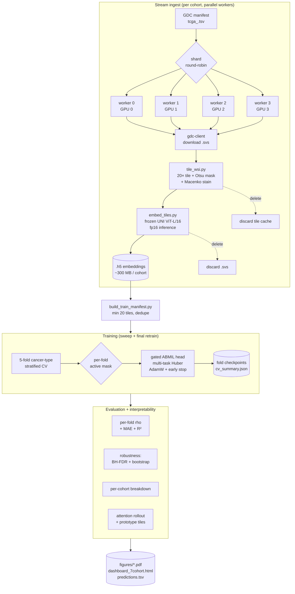
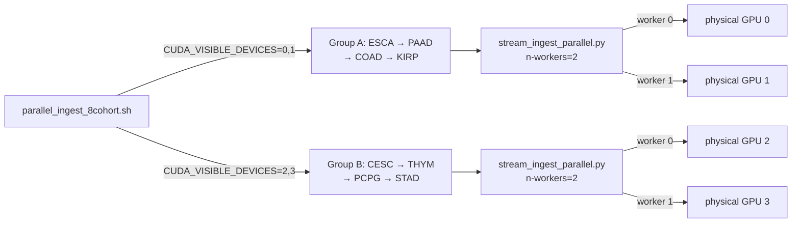
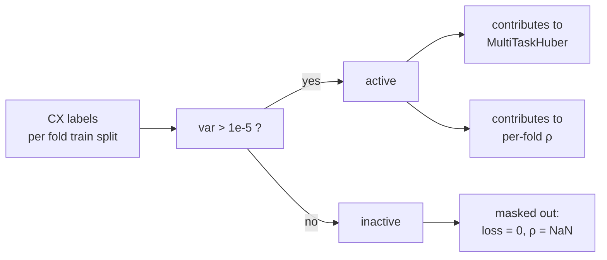
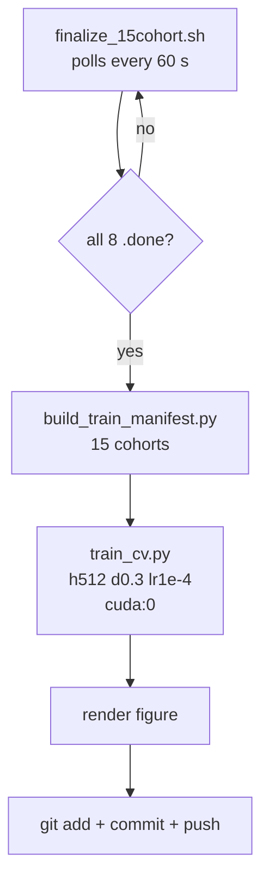

# Pipeline architecture

A visual overview of how a TCGA slide travels from the GDC servers to
a CIN signature prediction. Rendered diagrams below are mermaid; GitHub
renders them inline.

## End-to-end flow



## Stream-mode invariant

The pipeline never holds the full pan-cancer dataset on disk. At any
moment, peak disk footprint is bounded by:

```
peak ≈ N_workers × max(slide_size) + total_embeddings + transient_tiles
     ≈   4       ×   ~2 GB         + ~10 GB total    + ~few hundred MB
     ≈ ~20 GB
```

Final state for a complete pan-TCGA run (33 cohorts, ~30k slides) is
about 10 GB of embeddings. Raw slides are deleted as soon as their
`.h5` is written.

## GPU pinning



The `stream_ingest_parallel.py` script reads the parent's
`CUDA_VISIBLE_DEVICES` if set, splits it on commas, and assigns
`available_gpus[k % len(available_gpus)]` to worker k. This is what
makes two-cohort-parallel ingest actually use four physical GPUs
instead of collapsing onto the first two.

## Active signature mask



Pan-TCGA, this masks out CX7 and CX15 (zero in 100% of patients),
CX14 (99.9% zero), and CX13 (93% zero) in any fold whose training or
validation split is constant. The masked dimensions still flow through
the model but contribute nothing to gradient or metric.

## Stage 5 finalization (auto-triggered)



This is what makes the overnight run unattended: the launcher exits
after kicking off ingest, the auto-finalizer takes over once the eight
cohort markers all exist, and the headline 15-cohort figure lands on
`origin/main` without manual intervention.
